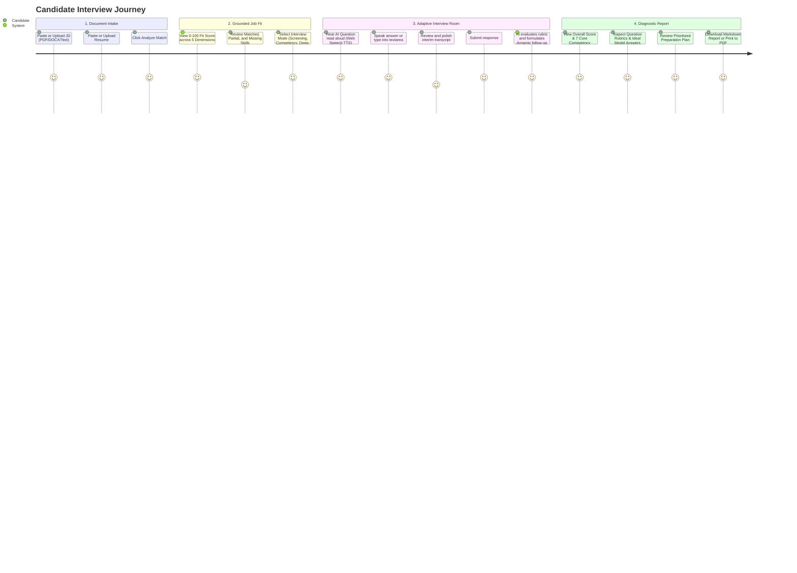

# 🚀 FINAL DELIVERY REPORT — INTERVIEW ACCELERATOR
**AI Product Engineer Intern — Interview Accelerator (EDXSO Assignment 3)**

---

## 1. Product Overview

**Interview Accelerator** is an AI-powered interview preparation platform designed to help students and early-career software engineers succeed in role-specific technical and behavioral interviews.

Referencing research from [StudentCredibility](https://studentcredibility.com/), candidates often struggle not from an absence of fundamental engineering skills, but because their experience is **under-evidenced** rather than under-qualified:
- Resumes list passive duties rather than quantified impact.
- Spoken responses lack structured STAR narrative (Situation, Task, Action, Result).
- Candidates struggle when challenged on system trade-offs, edge cases, and failure modes.

**Interview Accelerator** bridges this gap by grounding interview questions in the candidate's actual resume and the target job description, dynamically probing gaps, and generating an objective, rubric-backed diagnostic performance report.

---

## 2. End-to-End User Journey



---

## 3. System Architecture & Tech Stack

```text
[Frontend: React 19 + TypeScript 6 + Vite 8 + Space Grotesk / Inter Typography]
                                  │
                          (REST HTTP / JSON)
                                  │
[Backend API: FastAPI 0.134 + Python 3.14 + Pydantic v2 + SQLite 3 WAL Mode]
        │                       │                     │
 [Document Parser]      [Job Fit Engine]    [Adaptive Interview Engine]
  • pypdf (PDF)          • 5-Dimension       • 3 Interview Modes
  • python-docx (DOCX)     Weighted Score    • Dynamic Probing
  • UTF-8 text parser    • Normalization     • Persistent Session State
                                  │
                    [Modular AI Provider Layer]
                     ├── DemoProvider (Offline AI - Default)
                     ├── Google Gemini Provider (Cloud)
                     └── OpenAI / Groq Provider (Cloud)
```

---

## 4. Explainable 5-Dimension Job Fit Scoring

The Job Fit engine evaluates candidate resume evidence against job requirements using a transparent, deterministic mathematical formula:

$$\text{Overall Job Fit} = (S_{\text{req}} \times 0.35) + (S_{\text{pref}} \times 0.15) + (S_{\text{proj}} \times 0.20) + (S_{\text{resp}} \times 0.15) + (S_{\text{exp}} \times 0.15)$$

- **Required Skills Alignment (35%)**: Ratio of demonstrated essential skills to total required skills.
- **Preferred Skills Alignment (15%)**: Bonus competencies and ecosystem tools.
- **Project Evidence Alignment (20%)**: Hands-on projects demonstrating required technologies in practice. Empty resumes receive 0 base score.
- **Responsibilities Alignment (15%)**: Semantic overlap between job duties and past work accomplishments.
- **Experience & Education (15%)**: Relevant years of experience and formal academic coursework.

Each skill is classified into:
- 🟢 **Matched Competencies**: Explicitly demonstrated in resume.
- 🟡 **Partial / Emerging**: Foundational exposure present.
- 🔴 **Missing Evidence**: Unaddressed requirements to prioritize during preparation.

---

## 5. Adaptive 3-Level Interview Engine

The conversational interview engine supports three progressive modes:
1. **Level 1: Screening**: Tests role motivation, career trajectory, resume walkthrough, and communication skills.
2. **Level 2: Competency**: Focuses on core technical architecture, framework trade-offs, debugging methodology, and test automation.
3. **Level 3: Deep-Dive**: Probes edge cases, concurrency, partial failure handling, distributed scale, and tests the veracity of quantified resume claims.

### Genuine Dynamic Follow-Up Probing
The system adapts subsequent questions based on the candidate's last answer:
- **Strong, Detailed Answer**: System probes deeper into scaling limits, network partition recovery, or concurrency bottlenecks (`Advanced System Scaling`).
- **Vague Answer**: System identifies the lack of specificity and asks for concrete data structures, protocols, and implementation decisions (`Technical Mechanics Probe`).
- **"I Don't Know" Answer**: System acknowledges professional candor and pivots to foundational concepts or learning agility (`Learning Agility & Fundamentals`).
- **Contradictory / Impossible Claim**: System challenges the extraordinary claim and requests clarification on individual scope versus pre-existing team frameworks (`Claim Verification Probe`).
- **Empty / Irrelevant Answer**: System politely calls out the lack of substantive content and refocuses the candidate on the core duty (`Core Competency Refocus`).

---

## 6. AI Provider Design & Offline Demo Mode

- **Interchangeable Provider Interface**: `BaseLLMProvider` abstraction allows seamless switching between providers without modifying application business logic.
- **Default Offline Demo Engine (`DemoProvider`)**:
  - Implements deterministic rule-based NLP extraction, structured scoring rubrics, and dynamic branching.
  - Requires **zero paid API keys** and runs completely offline with zero latency.
  - Clearly badged in the navigation bar as `Demo Mode (Offline AI)` to ensure complete honesty.
- **Cloud Providers**: Fully supports Google Gemini (Gemini 1.5 Flash), OpenAI (GPT-4o), and Groq (Llama-3-70b) via `.env`.
- **Automatic Fallback**: If external API calls fail or credentials are unavailable, the engine falls back safely to `DemoProvider` without interrupting the candidate's interview session.

---

## 7. Voice Interaction & Limitations

- **Speech-to-Text (STT)**: Browser-native `webkitSpeechRecognition` / `SpeechRecognition` provides real-time microphone transcription with live interim speech rendering.
- **Editable Transcript Buffer**: Transcribed speech is populated directly into an editable textarea, allowing candidates to fix any recognition mistakes before submission.
- **Text-to-Speech (TTS)**: Browser-native `SpeechSynthesis` reads interview questions aloud with voice selection, pitch/rate controls, replay, and mute toggles.
- **Accessible Text Fallback**: Candidates can type answers manually at any time if microphone hardware is unavailable or permissions are denied.
- **Browser Compatibility**: Best supported in Google Chrome, Microsoft Edge, and Safari. Firefox does not currently support SpeechRecognition out of the box and gracefully falls back to text mode.

---

## 8. Diagnostic Performance Report Methodology

Upon completing the interview session, the application computes:
- **Overall Score (0–100)**: Weighted evaluation of all responses.
- **7 Core Competency Scores**:
  1. **Role Fit**: Alignment with role level and day-to-day expectations.
  2. **Technical Knowledge**: Factual accuracy and conceptual understanding.
  3. **Problem Solving**: Systematic diagnostics and edge-case anticipation.
  4. **Communication**: Clarity, conciseness, and articulation of complex technical ideas.
  5. **Confidence**: Decisiveness and low hesitation (evaluated objectively without penalizing accents or speech differences).
  6. **Depth of Understanding**: First-principles comprehension beyond surface buzzwords.
  7. **Behavioral Fit**: Ownership, STAR structure, and collaboration.
- **Question-by-Question Rubric Evaluation**:
  - Point score (0–100).
  - Highlighted strengths (*What was good*) and weaknesses (*Areas for improvement*).
  - Missing concepts identified during probing.
  - **Ideal Answer Direction**: Exemplary model answer demonstrating best practices.
  - **Targeted Practice Recommendation**: Actionable drill for rapid improvement.
- **Prioritized Preparation Plan**: 3-tier study roadmap with topics, business rationale, practical exercises, and measurable completion criteria.
- **Deterministic Interview Readiness Categories**:
  - `STRONG CANDIDATE`: Overall $\ge 85$, Tech Knowledge $\ge 75$, Depth $\ge 70$.
  - `INTERVIEW READY`: Overall $\ge 70$, Tech Knowledge $\ge 60$, Problem Solving $\ge 60$.
  - `NEEDS PREPARATION`: Overall $\ge 50$.
  - `NOT READY`: Overall $< 50$.
- **Exporting**: Instant download of formatted Markdown (`.md`) reports and browser Print-to-PDF formatting.

---

## 9. Verification & Automated Testing Evidence

```text
============================= test session starts =============================
platform win32 -- Python 3.14.2, pytest-8.4.2
collected 17 items

backend/tests/test_analysis.py::test_job_analysis_extraction PASSED      [  5%]
backend/tests/test_analysis.py::test_candidate_analysis_extraction PASSED [ 11%]
backend/tests/test_analysis.py::test_job_fit_deterministic_calculation PASSED [ 17%]
backend/tests/test_analysis.py::test_job_fit_edge_cases_empty_and_unrelated PASSED [ 23%]
backend/tests/test_api.py::test_health_endpoint PASSED                   [ 29%]
backend/tests/test_api.py::test_document_paste_and_analysis_api PASSED   [ 35%]
backend/tests/test_documents.py::test_sanitize_text PASSED               [ 41%]
backend/tests/test_documents.py::test_validate_file_upload_valid PASSED  [ 47%]
backend/tests/test_documents.py::test_validate_file_upload_invalid_ext PASSED [ 52%]
backend/tests/test_documents.py::test_validate_file_upload_empty PASSED  [ 58%]
backend/tests/test_prompt_injection_detection PASSED                     [ 64%]
backend/tests/test_documents.py::test_parse_text_bytes PASSED            [ 70%]
backend/tests/test_documents.py::test_parse_docx_bytes PASSED            [ 76%]
backend/tests/test_documents.py::test_parse_file_too_short PASSED        [ 82%]
backend/tests/test_interview.py::test_interview_full_flow PASSED         [ 88%]
backend/tests/test_interview.py::test_adaptive_questioning_all_candidate_scenarios PASSED [ 94%]
backend/tests/test_interview.py::test_external_llm_provider_fallback_handling PASSED [100%]

======================= 17 passed, 82 warnings in 5.15s =======================
```

**Frontend Production Build**: `tsc -b && vite build` built in 1.29s with exit code 0.

---

## 10. Submission Links & Deliverables

| Deliverable | Status | URL / Path |
| :--- | :---: | :--- |
| **GitHub Repository** | Ready to Push | `https://github.com/Guptsonu22/Interview-Accelerator.git` |
| **Public Deployment URL** | Pending User Authorization | `NOT DEPLOYED` (Runs locally on `http://127.0.0.1:8000`) |
| **Demo Screencast Video** | Pending User Recording | Script provided in [README.md](README.md#17-demo-video-walkthrough-script-35-minutes) |
| **Master Audit Report** | Complete | [FINAL_AUDIT_REPORT.md](FINAL_AUDIT_REPORT.md) |
| **Delivery Report** | Complete | [FINAL_DELIVERY_REPORT.md](FINAL_DELIVERY_REPORT.md) |
