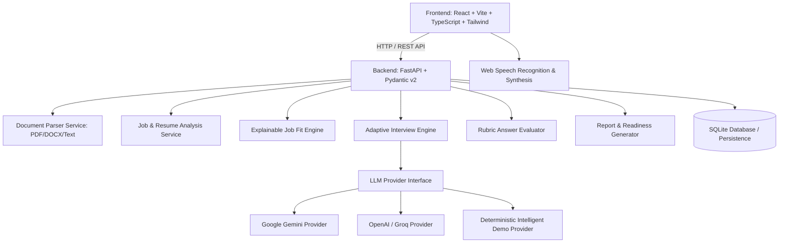

# Interview Accelerator — EDXSO Assignment 3 Implementation Plan

## Overview
Interview Accelerator is a full-stack, AI-driven preparation platform that transforms a Job Description and Candidate Resume into:
1. Grounded document extraction and analysis (Role Analysis & Candidate Evidence).
2. Deterministic, explainable Job Fit Scoring (0–100) with categorical breakdowns.
3. An adaptive, 3-level conversational interview engine (Screening, Competency, Deep-Dive).
4. Real-time voice interaction with Web Speech API (transcription, spoken questions, audio controls, text fallback).
5. Comprehensive Performance Report with 7 core competencies, question-level rubric evaluations, prioritized study roadmap, and deterministic Interview Readiness assessment.

---

## Architecture Plan

---

## Phase Breakdown

### Phase 1: Foundation & Inspection
- [x] Inspect environment, tools (Node 24, Python 3.14, Git 2.54, pip).
- [x] Inspect reference site (`studentcredibility.com`) and extract candidate pain points (under-evidenced vs under-qualified, lack of STAR stories, generic duties vs measured impact).
- [x] Establish PowerShell & Python shim for smooth tool execution.
- [ ] Initialize Backend skeleton: `backend/` with FastAPI, Pydantic, SQLite database models, config, and health check.
- [ ] Initialize Frontend skeleton: `frontend/` with Vite, React, TypeScript, Tailwind CSS, Lucide icons.

### Phase 2: Document Intake & Grounded Analysis
- [ ] Multi-format Document Parser (PDF via PyPDF/PyMuPDF, DOCX via python-docx, Plain Text).
- [ ] File validation (size limits, MIME types, empty text detection, untrusted prompt injection defense).
- [ ] Structured Job Description Analysis (Role, company, responsibilities, required/preferred skills, education, tools).
- [ ] Structured Resume Analysis (Candidate name, technical/soft skills, education, projects, achievements, quantified results).
- [ ] Categorized Matching (Explicitly demonstrated, Partially evidenced, Missing evidence).
- [ ] Deterministic Job Fit Scoring Engine (0–100 weighted formula across 5 dimensions with full reproducibility).

### Phase 3: Adaptive Interview Engine
- [ ] 3 Interview Modes:
  - **Level 1: Screening** (Motivation, career goals, resume walkthrough, communication, role fit).
  - **Level 2: Competency** (Technical fundamentals, practical application, project architecture, trade-offs).
  - **Level 3: Deep-Dive** (Technical depth, edge cases, failure handling, performance, challenging vague claims).
- [ ] Persistent Session State (Session ID, history, covered topics, difficulty trajectory, remaining questions).
- [ ] Dynamic Question Generator adapting to previous candidate answers, weak areas, and resume claims.
- [ ] Multi-factor Answer Evaluator (Relevance, technical correctness, depth, reasoning, clarity).

### Phase 4: Voice Interaction & Audio Experience
- [ ] Web Speech API Speech Recognition hook with continuous / phrase listening, interim transcript, pause/resume.
- [ ] Transcript editor for candidate review and correction before submission.
- [ ] Web Speech API Speech Synthesis for AI interviewer question playback (voice selection, mute/pause).
- [ ] Seamless text-based fallback when microphone is unavailable or denied.
- [ ] Visual audio waveform / active speaking indicators.

### Phase 5: Comprehensive Performance Report & Readiness Assessment
- [ ] Overall Interview Score (0–100) based on weighted rubric evaluations.
- [ ] 7 Core Competency Scores: Role Fit, Technical Knowledge, Problem Solving, Communication, Confidence, Depth of Understanding, Behavioral Fit.
- [ ] Question-by-Question Detailed Feedback: Candidate answer, score, rubric breakdown, what was good, what could be improved, missing concepts, ideal answer guide, personalized practice recommendations.
- [ ] Evidenced Strengths and Weaknesses.
- [ ] Prioritized Preparation Plan with study topics, rationale, practical drills, and completion criteria.
- [ ] Deterministic Interview Readiness Rating: `NOT READY`, `NEEDS PREPARATION`, `INTERVIEW READY`, `STRONG CANDIDATE`.
- [ ] Exportable report format (printable view, Markdown download, JSON export).

### Phase 6: UX Polish, Aesthetic Excellence & Reliability
- [ ] Modern UI with high visual craft: clean dark/light theme, typography (Space Grotesk & Inter), glassmorphism, responsive mobile & desktop layout.
- [ ] Error boundary, retry buttons, loading states, empty states, zero dead buttons.
- [ ] Session restore on page refresh.

### Phase 7: Acceptance Testing
- [ ] Automated pytest backend test suite covering:
  - Document parsing & validation
  - Job & resume analysis
  - Job fit calculation reproducibility
  - 3-level interview engine & dynamic question generation
  - Multi-factor evaluation rubric
  - 7 competency aggregations & readiness thresholds
  - Provider fallback handling
- [ ] Frontend production build validation (`npm run build`).
- [ ] End-to-end browser verification using browser subagent with real voice/speech verification.

### Phase 8: Deployment & Documentation
- [ ] Comprehensive README with Windows PowerShell startup commands, architecture diagrams, scoring rubrics.
- [ ] `.env.example` with provider instructions.
- [ ] Production-ready Dockerfile and deployment configurations.
