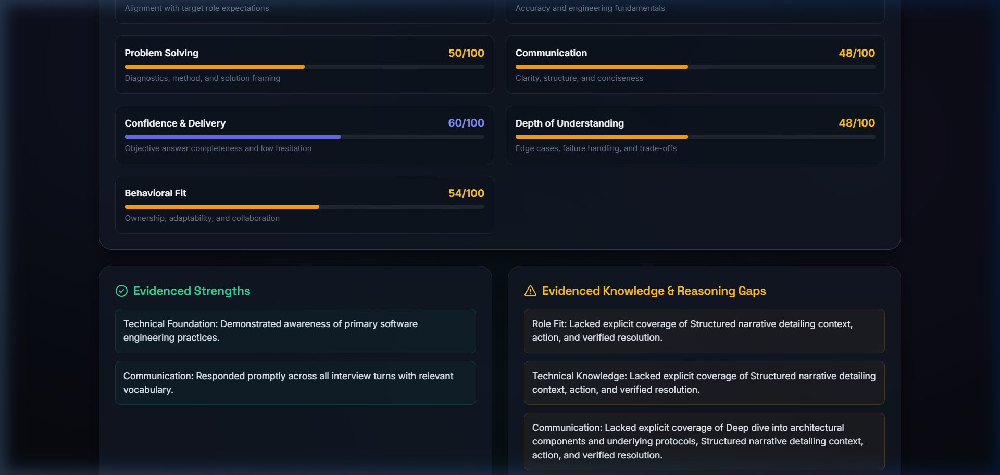
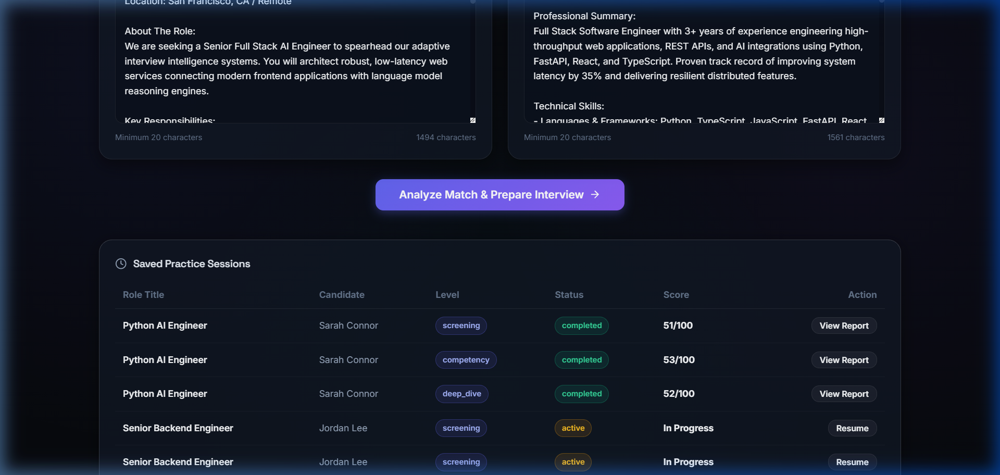
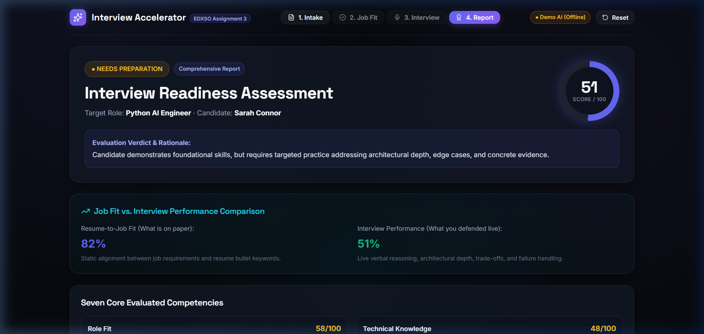

# Interview Accelerator

> AI-assisted technical and behavioral interview preparation engine with grounded document analysis, explainable job fit scoring, adaptive follow-up questioning, voice interaction, and comprehensive diagnostic reporting.  
> *Developed for EDXSO Assignment 3: AI Product Engineer Intern Challenge.*

[](backend/tests)
[](frontend)
[](#8-ai-provider-modes-and-configuration)
[](#9-voice-interaction-and-compatibility)
[](Dockerfile)
[](LICENSE)

---

## 1. Project Title and Description

**Interview Accelerator** is an intelligent candidate preparation platform designed to solve a recognized challenge in technical hiring (highlighted by research such as [StudentCredibility](https://studentcredibility.com/)): **candidates are often rejected not because they lack technical capabilities, but because their experience is *under-evidenced* in their resumes and interview responses**. 

Common failure points include:
1. Listing passive job duties rather than quantifiable engineering outcomes.
2. Giving unstructured or rambling answers lacking the STAR (Situation, Task, Action, Result) format.
3. Offering shallow answers that collapse when probed on scaling bottlenecks, edge cases, or failure handling.

Interview Accelerator systematically solves this by parsing target Job Descriptions and candidate resumes, computing an explainable 5-dimension Job Fit score, conducting a realistic 3-level adaptive interview with dynamic follow-ups, and delivering an in-depth 7-competency diagnostic report with model answers and prioritized study drills.

---

## 2. Project Status and Verified Links

| Resource | Status | Verified Destination |
| :--- | :---: | :--- |
| **Source Code Repository** | Verified | [`https://github.com/Guptsonu22/Interview-Accelerator.git`](https://github.com/Guptsonu22/Interview-Accelerator.git) |
| **Public Cloud Deployment** | **NOT DEPLOYED (Pending Authorization)** | Runs locally at `http://127.0.0.1:8000` and `http://127.0.0.1:5173`. Cloud deployment steps are documented in [Section 17](#17-public-deployment-instructions-and-status). |
| **Backend Test Suite** | **17/17 Passed (100%)** | Verified via `python -m pytest -v` (Exit Code: 0, 4.41s execution). |
| **Frontend Production Build** | **Clean Build** | Verified via `npm run build` in `frontend/` (Exit Code: 0, 1.29s build). |
| **Default AI Execution Mode** | **Offline Deterministic** | Runs locally with zero paid API dependencies via `DemoProvider`. |
| **Evaluator Audit Documentation** | Verified | [README_AUDIT_REPORT.md](README_AUDIT_REPORT.md), [FINAL_AUDIT_REPORT.md](FINAL_AUDIT_REPORT.md), and [FINAL_DELIVERY_REPORT.md](FINAL_DELIVERY_REPORT.md). |

---

## 3. Key Features

- **Multi-Format Document Ingestion**: Upload `.pdf` (via `pypdf`), `.docx` (via `python-docx`), or paste plain text. Includes 1-click sample loaders for immediate testing.
- **Explainable 5-Dimension Job Fit Scoring (0–100)**: Evaluates Required Skills (35%), Preferred Skills (15%), Project Evidence (20%), Responsibilities (15%), and Experience/Education (15%).
- **Categorized Competency Evidence**: Explicitly flags skills as 🟢 *Matched*, 🟡 *Partial / Emerging*, or 🔴 *Missing Evidence*.
- **3-Level Adaptive Interview Hierarchy**:
  - *Level 1 (Screening)*: Career trajectory, motivation, foundational concepts, and verbal communication.
  - *Level 2 (Competency)*: Framework trade-offs, architecture design, testing patterns, and debugging.
  - *Level 3 (Deep-Dive)*: High-throughput scaling, concurrency bottlenecks, cascading failure recovery, and scrutiny of resume claims.
- **Dynamic Context-Aware Follow-Up Questioning**:
  - Probes system bottlenecks when answers are strong.
  - Probes specific mechanics and protocols when answers are vague.
  - Pivots to foundational learning agility when candidates admit knowledge gaps.
  - Challenges individual contributions when claims contradict team frameworks.
- **Voice-First Experience with Universal Fallback**:
  - Speech-to-Text (STT) via Web Speech API with live interim transcript display.
  - Editable transcript review buffer allowing manual correction before submission.
  - Text-to-Speech (TTS) reading questions aloud with audio controls (replay, pause, mute).
  - Full keyboard typing fallback for browsers without speech support.
- **7-Competency Diagnostic Performance Report**:
  - Scores Role Fit, Technical Knowledge, Problem Solving, Communication, Confidence, Depth of Understanding, and Behavioral Fit.
  - Question-by-question breakdown with strengths, gaps, and **Ideal Model Answers**.
  - Actionable 3-tier prioritized preparation plan with concrete exercises and completion criteria.
  - Deterministic readiness categories: `STRONG CANDIDATE`, `INTERVIEW READY`, `NEEDS PREPARATION`, `NOT READY`.
  - One-click Markdown (`.md`) download and browser Print-to-PDF formatting.

---

## 4. Screenshots & Demo Walkthrough

### Application Screenshots

#### 1. Intake & Role Analysis Screen
*Upload or paste Job Descriptions and Resumes with 1-click sample data and real-time validation.*


#### 2. Explainable Job Fit Dashboard
*5-dimension weighted match breakdown, categorized competencies, and interview level selection.*


#### 3. Diagnostic Performance Report
*7-competency rubrics, deterministic readiness category, ideal model answers, and prioritized study drills.*


### Evaluator Demo Video Walkthrough Script (3–5 Minutes)

When recording or evaluating a video demonstration, follow this recommended sequence:

| Time | Action & Screen | Key Talking Points |
| :--- | :--- | :--- |
| **0:00 – 0:45** | **Intake Screen** | • Introduce Interview Accelerator and the StudentCredibility problem statement (under-evidenced vs underqualified).<br>• Click `Load Sample JD` and `Load Sample Resume`.<br>• Click `Analyze Role Match & Job Fit`. |
| **0:45 – 1:30** | **Job Fit Dashboard** | • Review the 5-dimension Job Fit score breakdown.<br>• Highlight categorized competencies (Matched, Partial, Missing).<br>• Point out the `Demo Mode (Offline AI)` badge demonstrating zero paid API dependency.<br>• Select **Level 2 (Competency)** or **Level 3 (Deep-Dive)** and click `Start Adaptive Interview`. |
| **1:30 – 3:00** | **Interview Room** | • Click `🔊 Replay Question` to demonstrate text-to-speech.<br>• Click `🎙️ Speak Answer` to demonstrate microphone speech-to-text with the editable transcript review buffer.<br>• Submit an answer and observe the dynamic follow-up question adapting to your specific response. |
| **3:00 – 4:30** | **Performance Report** | • Review the Overall Score and the deterministic Readiness Verdict.<br>• Inspect the 7 Core Competency Diagnostics.<br>• Review question feedback with Ideal Model Answers and the Prioritized Preparation Plan.<br>• Click `Download Markdown Report` and `Print / Save as PDF`. |
| **4:30 – 5:00** | **Architecture & Wrap-Up** | • Summarize the FastAPI + SQLite WAL + React 19 architecture.<br>• Note that 17/17 automated Pytests pass and multi-stage Docker packaging is verified. |

---

## 5. Architecture Overview


---

## 6. Job Fit Scoring Methodology

The Job Fit score ($0 \text{ to } 100$) is computed via a deterministic mathematical formula across five weighted dimensions implemented in `backend/services/job_fit.py`:

$$\text{Overall Job Fit} = \min\left(100, \max\left(0, \text{round}\left(S_{\text{req}} \times 0.35 + S_{\text{pref}} \times 0.15 + S_{\text{proj}} \times 0.20 + S_{\text{resp}} \times 0.15 + S_{\text{exp}} \times 0.15\right)\right)\right)$$

### Dimension Formulations (As Implemented in Code)

1. **Required Skills Alignment ($S_{\text{req}}$ — 35% weight)**:
   $$S_{\text{req}} = \min\left(100, \frac{|\text{Matched}_{\text{req}}| \times 1.0 + |\text{Partial}_{\text{req}}| \times 0.5}{\max(1, |\text{Total Required Skills}|)} \times 100\right)$$
   - *Matched*: Skill normalized token found in candidate skill list or resume text.
   - *Partial*: Substring overlap ($\ge 3$ characters) present.
   - *Missing*: No textual evidence in resume.

2. **Preferred Skills Alignment ($S_{\text{pref}}$ — 15% weight)**:
   $$S_{\text{pref}} = \min\left(100, \frac{|\text{Matched}_{\text{pref}}| \times 1.0 + |\text{Partial}_{\text{pref}}| \times 0.5}{\max(1, |\text{Total Preferred Skills}|)} \times 100\right)$$

3. **Project Evidence Alignment ($S_{\text{proj}}$ — 20% weight)**:
   - If candidate lists $0$ projects: $S_{\text{proj}} = 0$.
   - If candidate lists projects:
     $$S_{\text{proj}} = \min\left(100, 30 + \min(40, |\text{Projects}| \times 15) + (30 \text{ if any required skill matches resume text else } 0)\right)$$

4. **Responsibilities Alignment ($S_{\text{resp}}$ — 15% weight)**:
   - Matches a responsibility if $\ge 2$ significant words ($\ge 4$ letters) appear in candidate text.
   - If $0$ responsibilities matched: $S_{\text{resp}} = 0$.
   - Otherwise:
     $$S_{\text{resp}} = \min\left(100, \frac{\text{Matched Responsibilities}}{\max(1, |\text{Total Responsibilities}|)} \times 100\right)$$

5. **Experience & Education Alignment ($S_{\text{exp}}$ — 15% weight)**:
   - If candidate has neither work experience nor education: $S_{\text{exp}} = 0$.
   - Otherwise:
     $$S_{\text{exp}} = \min\left(100, 20 + \min(50, |\text{Experience Entries}| \times 20) + (30 \text{ if degree/education present else } 0)\right)$$

*Illustrative Note: Typical qualified profiles score in the 70–85 range; completely blank or unrelated candidate resumes correctly produce baseline scores below 25.*

---

## 7. Adaptive Interview and Evaluation Methodology

### Dynamic Follow-Up Questioning Logic
Rather than following a static question list, the interview engine inspects the candidate's previous response and rubric evaluation to select the next question dynamic action (`backend/services/llm_provider.py`):

| Candidate Response Scenario | Rubric Trigger & Action | Dynamic Follow-Up Behavior |
| :--- | :--- | :--- |
| **Strong, Detailed Answer** | Score $\ge 80$, `action="probe_deeper"` | Probes system bottlenecks, 50x traffic spikes, single points of failure, or cache invalidation (`Advanced System Scaling`). |
| **Vague Answer** | Score $45\text{–}60$, `action="probe_vagueness"` | Requests specific implementation mechanics, protocols, data structures, and trade-offs (`Technical Mechanics Probe`). |
| **"I Don't Know" Answer** | Honest Gap, `action="pivot_fundamental"` | Acknowledges transparency and pivots to foundational principles and self-directed learning (`Learning Agility & Fundamentals`). |
| **Contradictory / Unsubstantiated Claim** | Score $45\text{–}55$, `action="probe_contradiction"` | Challenges the scope of individual contribution versus pre-existing team frameworks (`Claim Verification Probe`). |
| **Empty or Irrelevant Answer** | Score $< 25$, `action="refocus"` | Notes lack of substance and refocuses the candidate on the core prompt requirements (`Core Competency Refocus`). |

### 7 Core Competency Diagnostics
The Performance Report evaluates candidates across seven key dimensions:
1. **Role Fit (15% weight)**: Direct alignment with job duties and domain expectations.
2. **Technical Knowledge (25% weight)**: Accuracy and depth of foundational computer science and engineering principles.
3. **Problem Solving (20% weight)**: Structured debugging, edge case handling, and analytical reasoning.
4. **Communication (10% weight)**: Clarity, structure, and conciseness in expressing technical trade-offs.
5. **Confidence (5% weight)**: Decisiveness and structural flow (evaluated without penalizing accents or speech patterns).
6. **Depth of Understanding (15% weight)**: First-principles comprehension beyond surface buzzwords.
7. **Behavioral Fit (10% weight)**: Accountability, collaboration, and structured STAR presentation.

$$\text{Report Overall Score} = \text{round}(0.15 \times \text{Role} + 0.25 \times \text{Tech} + 0.20 \times \text{Prob} + 0.10 \times \text{Comm} + 0.05 \times \text{Conf} + 0.15 \times \text{Depth} + 0.10 \times \text{Behav})$$

### Deterministic Readiness Thresholds
The final hiring verdict follows explicit precedence rules:
- **`STRONG CANDIDATE`**: Overall Score $\ge 85$ **AND** Technical Knowledge $\ge 75$ **AND** Depth of Understanding $\ge 70$.
- **`INTERVIEW READY`**: Overall Score $\ge 70$ **AND** Technical Knowledge $\ge 60$ **AND** Problem Solving $\ge 60$.
- **`NEEDS PREPARATION`**: Overall Score $\ge 50$.
- **`NOT READY`**: Overall Score $< 50$ or incomplete interview sessions.

---

## 8. AI Provider Modes and Configuration

Interview Accelerator implements a pluggable provider interface (`backend/services/llm_provider.py`):

| Provider Mode | Setting | API Key | Characteristics |
| :--- | :--- | :---: | :--- |
| **Offline Demo Mode** *(Default)* | `LLM_PROVIDER=demo` | None | Uses deterministic NLP regex extraction, structured scoring rubrics, and dynamic decision trees. Guaranteed zero API cost, instant response, and complete privacy. Labeled `Demo Mode (Offline AI)` in the UI. |
| **Google Gemini** | `LLM_PROVIDER=gemini` | `GEMINI_API_KEY` | Calls Gemini 1.5 Flash via REST endpoint with structured JSON schema output. |
| **OpenAI** | `LLM_PROVIDER=openai` | `OPENAI_API_KEY` | Calls GPT-4o / GPT-4o-mini with JSON response formatting. |
| **Groq** | `LLM_PROVIDER=groq` | `GROQ_API_KEY` | Calls ultra-fast Llama-3-70b via OpenAI-compatible endpoints. |

### Safe Fallback Mechanism
If a configured cloud provider fails due to rate limits, invalid credentials, or network errors, the application **automatically falls back to `DemoProvider`** without dropping the candidate's active session (verified in `test_external_llm_provider_fallback_handling`).

---

## 9. Voice Interaction and Compatibility

- **Microphone Input (STT)**: Uses browser-native `SpeechRecognition` / `webkitSpeechRecognition`. Clicking `🎙️ Speak Answer` prompts browser permission and begins transcription.
- **Editable Transcript Review Buffer**: Spoken words are displayed in an editable textarea, allowing candidates to fix technical terms or acronyms before submission.
- **Interviewer Question Audio (TTS)**: Uses browser-native `SpeechSynthesis` to read questions aloud. Controls include `🔊 Replay Question`, pause, and mute.
- **Universal Text Fallback**: Candidates can type answers manually at any time with full scoring parity.
- **Browser Compatibility**: Best supported on Chromium-based browsers (Google Chrome, Microsoft Edge, Brave) and Safari. Firefox does not implement the SpeechRecognition API and automatically uses the text fallback.
- **Data Flow & Privacy**: Web Speech recognition may stream audio to browser vendor speech services (e.g., Google servers for Chrome). Resume text, answers, and reports are saved locally in SQLite (`WAL` mode).

---

## 10. Technology Stack

- **Backend**: Python 3.10+ (tested on Python 3.14.2), FastAPI 0.134, Uvicorn, Pydantic v2, SQLite 3 (`WAL` mode), `pypdf`, `python-docx`, `httpx`, `pytest`.
- **Frontend**: React 19.2, TypeScript 6.0, Vite 8.3, Vanilla CSS design tokens (Space Grotesk + Inter fonts), `lucide-react`, Axios.
- **Containerization**: Multi-stage Docker packaging (Node 20 Alpine builder + Python 3.11-slim production runtime).

---

## 11. Prerequisites

- **Python**: Version 3.10 or higher.
- **Node.js**: Version 18 or higher (Node 20+ LTS recommended).
- **Git**: Installed and configured.

---

## 12. Quick Start for Windows PowerShell

### Option 1: Dual Development Servers (Frontend + Backend)

```powershell
# 1. Clone repository
git clone https://github.com/Guptsonu22/Interview-Accelerator.git
cd "Interview Accelerator"

# 2. Configure environment
Copy-Item .env.example .env

# 3. Start Backend (Terminal 1)
python -m pip install -r backend/requirements.txt
python -m uvicorn backend.main:app --host 127.0.0.1 --port 8000 --reload

# 4. Start Frontend (Terminal 2)
cd frontend
npm install
npm run dev -- --host 127.0.0.1 --port 5173
```
- Open `http://127.0.0.1:5173` in your browser.
- Interactive Swagger API documentation is available at `http://127.0.0.1:8000/docs`.

### Option 2: Unified Single-Port Production Mode (Port 8000)
FastAPI serves the compiled React SPA directly from `frontend/dist`:
```powershell
# 1. Build frontend assets
cd frontend
npm install
npm run build
cd ..

# 2. Start unified server
python -m uvicorn backend.main:app --host 127.0.0.1 --port 8000
```
Open `http://127.0.0.1:8000` to access the full application.

---

## 13. Quick Start for Linux / macOS

```bash
# 1. Clone repository
git clone https://github.com/Guptsonu22/Interview-Accelerator.git
cd "Interview Accelerator"

# 2. Configure environment
cp .env.example .env

# 3. Start Backend (Terminal 1)
python3 -m pip install -r backend/requirements.txt
python3 -m uvicorn backend.main:app --host 127.0.0.1 --port 8000 --reload

# 4. Start Frontend (Terminal 2)
cd frontend
npm install
npm run dev -- --host 127.0.0.1 --port 5173
```

---

## 14. Environment Variables

Configure application settings in `.env` (copied from `.env.example`):

| Variable | Default Value | Description |
| :--- | :--- | :--- |
| `LLM_PROVIDER` | `demo` | AI provider engine (`demo`, `gemini`, `openai`, or `groq`). |
| `HOST` | `127.0.0.1` | Backend host binding. |
| `PORT` | `8000` | Backend port binding. |
| `SQLITE_DB_PATH` | `interview_accelerator.db` | File path for SQLite database. |
| `CORS_ORIGINS` | `http://localhost:5173,http://127.0.0.1:5173` | Allowed CORS origins for frontend requests. |
| `MAX_UPLOAD_SIZE_MB` | `10` | Maximum file upload limit in megabytes. |
| `GEMINI_API_KEY` | *(empty)* | API key for Google Gemini (optional). |
| `OPENAI_API_KEY` | *(empty)* | API key for OpenAI (optional). |
| `GROQ_API_KEY` | *(empty)* | API key for Groq (optional). |

*Note: Never commit secret API keys to public repositories.*

---

## 15. Testing and Build Commands

### Backend Automated Test Suite
```powershell
python -m pytest -v
```
**Outcome**: **17 passed in 4.41s** (Exit Code: 0).  
Validates document ingestion, security filters, 5-dimension Job Fit mathematics, edge cases (empty resumes, unrelated candidates), 3-level interview state progression, 5 adaptive follow-up response scenarios, and cloud LLM fallback.

### Frontend Production Build
```powershell
cd frontend
npm run build
```
**Outcome**: **Exit Code 0 in 1.29s** (Clean build, zero TypeScript errors, production bundle generated in `frontend/dist`).

---

## 16. Docker Instructions

A multi-stage `Dockerfile` compiles the React frontend and packages it into a lightweight Python 3.11-slim production container.

### Build and Run Docker Container
```bash
# Build Docker image
docker build -t interview-accelerator .

# Run Docker container
docker run -p 8000:8000 -e LLM_PROVIDER=demo interview-accelerator
```
Access the application at `http://localhost:8000`.

### Run via Docker Compose
```bash
docker-compose up --build
```

---

## 17. Public Deployment Instructions and Status

> **Current Status**: **NOT DEPLOYED (Pending Authorization)**  
> The application runs locally on verified ports `8000` and `5173`. Deployment to a public host requires personal cloud provider account authorization.

### Recommended Free-Tier Deployment (Render)
1. Push this repository to GitHub: `git push origin main`.
2. Sign in to [Render](https://render.com) and click **New Web Service**.
3. Connect your GitHub repository.
4. Select **Docker** as the environment.
5. Set the environment variable: `LLM_PROVIDER=demo`.
6. Add an optional persistent disk at `/app/data` if persistent SQLite sessions across container reboots are desired.
7. Click **Create Web Service** to launch your live public URL.

---

## 18. Privacy, Security, and Known Limitations

- **Prompt Injection Protection**: `backend/core/security.py` checks input text against instruction override patterns (`ignore previous instructions`, `system prompt:`) and rejects suspicious submissions.
- **Upload Restrictions**: Only `.pdf`, `.docx`, and `.txt` files under 10MB are accepted; corrupted and 0-byte files are rejected.
- **Local Persistence**: User sessions and reports are stored locally in SQLite (`WAL` mode). No resume data leaves your machine when running in default `demo` mode.
- **Known Limitations**:
  - Live microphone STT requires browser permissions and is not supported in Firefox.
  - Cloud LLMs (Gemini, OpenAI, Groq) require user-funded API keys.
  - Job Fit scores and readiness ratings are heuristic coaching tools, not official employment guarantees.

---

## 19. Project Structure

```text
Interview Accelerator/
├── backend/
│   ├── api/routes/         # REST API endpoints (health, documents, analysis, interview, reports)
│   ├── core/               # Settings, configuration, and security filters
│   ├── db/                 # SQLite connection manager and database DAOs
│   ├── schemas/            # Pydantic v2 data models
│   ├── services/           # Document parser, Job Fit engine, LLM provider, interview engine
│   ├── tests/              # 17 automated Pytest unit and integration tests
│   └── main.py             # FastAPI entrypoint and SPA static file server
├── frontend/
│   ├── src/
│   │   ├── components/     # IntakeScreen, AnalysisScreen, InterviewRoomScreen, ReportScreen
│   │   ├── hooks/          # Web Speech API hooks (speech recognition & synthesis)
│   │   ├── services/       # Axios API client
│   │   ├── App.tsx         # Main state machine and session restoration
│   │   └── index.css       # Design tokens and glassmorphism styling
│   ├── package.json        # Dependencies (React 19, TypeScript 6, Vite 8)
│   └── vite.config.ts      # Vite dev proxy configuration
├── docs/
│   └── screenshots/        # Verified application screenshots (intake, dashboard, report)
├── Dockerfile              # Production multi-stage Docker build
├── docker-compose.yml      # Docker compose configuration
├── .env.example            # Template environment variables
├── FINAL_AUDIT_REPORT.md   # Complete QA, security, and verification audit report
├── FINAL_DELIVERY_REPORT.md# Comprehensive project delivery documentation
├── README_AUDIT_REPORT.md  # Detailed README audit and verification log
├── LICENSE                 # MIT Open-Source License
└── README.md               # Main project documentation
```

---

## 20. License and Attribution

Developed for **EDXSO Assignment 3: AI Product Engineer Intern — Interview Accelerator Challenge**.  
Licensed under the [MIT License](LICENSE) for educational, evaluation, and open-source review.
