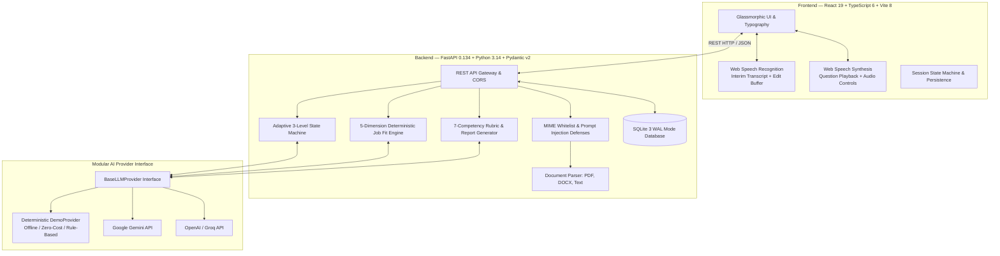

# Interview Accelerator
> AI-assisted technical and behavioral interview preparation engine with grounded document analysis, explainable job fit scoring, adaptive follow-up questioning, and voice interaction.  
> *Developed for EDXSO Assignment 3: AI Product Engineer Intern.*

[](backend/tests)
[](frontend)
[](#8-ai-provider-modes-and-configuration)
[](#9-voice-interaction-and-compatibility)
[](Dockerfile)

---

## 1. Project Overview & Status

Interview Accelerator addresses a core finding from technical hiring research (such as benchmarks highlighted by [StudentCredibility](https://studentcredibility.com/)): **candidates frequently underperform in technical interviews because their experience is *under-evidenced* rather than under-qualified**. Common failure patterns include generic duty listings without measurable outcomes, disorganized responses lacking STAR structure, and shallow answers that collapse when probed on edge cases or architectural trade-offs.

Interview Accelerator systematically evaluates both the target Job Description (JD) and the candidate's resume, computes a deterministic 5-dimension Job Fit score, conducts an adaptive multi-level interview, and generates a detailed diagnostic Performance Report across 7 core competencies.

### Verified Repository & Deployment Status
- **Source Repository**: [`https://github.com/Guptsonu22/Interview-Accelerator.git`](https://github.com/Guptsonu22/Interview-Accelerator.git)
- **Public Cloud Deployment**: **Pending User Authorization** (The application runs locally on `http://127.0.0.1:8000` and `http://127.0.0.1:5173`. Public cloud deployment to Render or Railway requires user account authorization).
- **Default AI Mode**: Runs locally and offline with **zero paid API dependencies** using `DemoProvider`. Cloud models (Google Gemini, OpenAI, Groq) can be enabled via `.env`.
- **Automated Tests**: 17 backend unit and integration tests passing (`python -m pytest -v`); frontend production bundle builds cleanly (`npm run build`).

---

## 2. Key Features

- **Multi-Format Document Intake**: Upload `.pdf` (via `pypdf`), `.docx` (via `python-docx`), or paste plain text. Includes 1-click sample loaders for immediate testing.
- **Explainable Job Fit Scoring (0–100)**: Transparent 5-dimension model evaluating Required Skills (35%), Preferred Skills (15%), Project Evidence (20%), Responsibilities (15%), and Experience/Education (15%).
- **Categorized Evidence Breakdown**: Explicitly groups competencies into 🟢 *Matched*, 🟡 *Partial / Emerging*, and 🔴 *Missing Evidence*.
- **3 Adaptive Interview Modes**:
  - *Level 1 (Screening)*: Evaluates career background, motivation, role alignment, and communication.
  - *Level 2 (Competency)*: Tests practical architecture, framework trade-offs, debugging, and automated testing.
  - *Level 3 (Deep-Dive)*: Probes concurrency, edge cases, failure handling, and challenges unsubstantiated claims.
- **Genuine Adaptive Questioning**: Analyzes candidate answers to generate context-dependent follow-ups (probing scaling bottlenecks on strong answers, mechanics on vague answers, fundamentals on admissions of knowledge gaps, and individual contributions on contradictory claims).
- **Voice-First Interaction with Accessible Fallback**:
  - Speech-to-Text via browser `SpeechRecognition` with live interim transcription.
  - Editable transcript review buffer allowing candidate corrections before submission.
  - Text-to-Speech via `SpeechSynthesis` reading questions aloud with audio controls (replay, pause, mute).
  - Accessible typing mode when microphone permissions are denied or unsupported.
- **7-Competency Diagnostic Report**:
  - Role Fit, Technical Knowledge, Problem Solving, Communication, Confidence, Depth of Understanding, and Behavioral Fit.
  - Question-level rubric evaluations with identified strengths, improvement areas, and **Ideal Model Answers**.
  - Prioritized 3-tier preparation plan with actionable study drills and completion criteria.
  - Deterministic readiness categories: `STRONG CANDIDATE`, `INTERVIEW READY`, `NEEDS PREPARATION`, `NOT READY`.
  - One-click export to formatted Markdown (`.md`) and browser Print-to-PDF.

---

## 3. Architecture Overview



---

## 4. Job Fit Scoring Methodology

The Job Fit score ($0 \text{ to } 100$) is computed via a deterministic mathematical formula across five weighted dimensions:

$$\text{Overall Job Fit} = (S_{\text{req}} \times 0.35) + (S_{\text{pref}} \times 0.15) + (S_{\text{proj}} \times 0.20) + (S_{\text{resp}} \times 0.15) + (S_{\text{exp}} \times 0.15)$$

### Dimension Formulations (As Implemented in Code)
1. **Required Skills Alignment ($S_{\text{req}}$ — 35%)**:
   $$S_{\text{req}} = \min\left(100, \frac{|\text{Matched}_{\text{req}}| \times 1.0 + |\text{Partial}_{\text{req}}| \times 0.5}{|\text{Total Required Skills}|} \times 100\right)$$
2. **Preferred Skills Alignment ($S_{\text{pref}}$ — 15%)**:
   $$S_{\text{pref}} = \min\left(100, \frac{|\text{Matched}_{\text{pref}}| \times 1.0 + |\text{Partial}_{\text{pref}}| \times 0.5}{|\text{Total Preferred Skills}|} \times 100\right)$$
3. **Project Evidence Alignment ($S_{\text{proj}}$ — 20%)**:
   - If candidate lists $0$ projects: $S_{\text{proj}} = 0$.
   - If candidate lists projects: $S_{\text{proj}} = \min(100, 30 + \min(40, |\text{Projects}| \times 15) + 30 \times \mathbb{I}(\text{technology match}))$.
4. **Responsibilities Alignment ($S_{\text{resp}}$ — 15%)**:
   - If $0$ responsibilities matched: $S_{\text{resp}} = 0$.
   - Otherwise: $S_{\text{resp}} = \min\left(100, \frac{\text{Matched Responsibilities}}{\text{Total Responsibilities}} \times 100\right)$.
5. **Experience & Education Alignment ($S_{\text{exp}}$ — 15%)**:
   - If candidate has neither experience nor degree: $S_{\text{exp}} = 0$.
   - Otherwise: $S_{\text{exp}} = \min(100, 20 + \min(50, |\text{Experience Entries}| \times 20) + 30 \times \mathbb{I}(\text{degree present}))$.

*Note: Illustrative sample match runs on typical engineering profiles produce scores in the 70–85 range; completely empty or unrelated profiles correctly yield baseline scores below 25.*

---

## 5. Adaptive Interview & Evaluation Methodology

### Dynamic Follow-Up Questioning
The interview engine analyzes previous turn evaluations and dynamically formulates the next question:

| Candidate Response Scenario | System Evaluation | Next Question Dynamic Behavior |
| :--- | :--- | :--- |
| **Strong, Detailed Answer** (STAR structure, metrics, technical depth) | High Rubric Score ($\ge 80$), `next_action="probe_deeper"` | Probes deeper into system scaling limits, 50x traffic spikes, or single points of failure (`Advanced System Scaling`). |
| **Vague Answer** (short, lacking architecture or metrics) | Moderate Score ($45\text{–}60$), `next_action="probe_vagueness"` | Requests specific implementation mechanics, protocols, data structures, and trade-offs (`Technical Mechanics Probe`). |
| **"I Don't Know" Answer** (candor / knowledge gap) | Honest Admission Score ($40\text{–}45$), `next_action="pivot_fundamental"` | Acknowledges candor and pivots to foundational principles and learning agility (`Learning Agility & Fundamentals`). |
| **Contradictory / Unverifiable Claim** | Challenged Score ($45\text{–}55$), `next_action="probe_contradiction"` | Challenges the scope of individual contribution versus pre-existing team frameworks (`Claim Verification Probe`). |
| **Empty or Irrelevant Answer** | Low Score ($< 25$), `next_action="refocus"` | Notes the lack of technical substance and refocuses the candidate on the core prompt (`Core Competency Refocus`). |

### 7 Core Competency Scores
Each competency is scored from $0$ to $100$ using explicit rubric criteria:
1. **Role Fit**: Direct alignment with role expectations and responsibilities.
2. **Technical Knowledge**: Accuracy and depth of engineering fundamentals.
3. **Problem Solving**: Systematic diagnostics, debugging, and edge-case anticipation.
4. **Communication**: Clarity, conciseness, and articulation of technical concepts.
5. **Confidence**: Decisiveness and low hesitation (evaluated objectively without penalizing accents or speech patterns).
6. **Depth of Understanding**: First-principles comprehension beyond surface buzzwords.
7. **Behavioral Fit**: Ownership, collaboration, learning agility, and STAR framing.

### Deterministic Readiness Thresholds
The final verdict is derived from deterministic rules:
- **`STRONG CANDIDATE`**: Overall Score $\ge 85$, Technical Knowledge $\ge 75$, Depth of Understanding $\ge 70$.
- **`INTERVIEW READY`**: Overall Score $\ge 70$, Technical Knowledge $\ge 60$, Problem Solving $\ge 60$.
- **`NEEDS PREPARATION`**: Overall Score $\ge 50$.
- **`NOT READY`**: Overall Score $< 50$.

---

## 6. AI Provider Modes and Configuration

Interview Accelerator uses a modular provider interface (`backend/services/llm_provider.py`).

| Mode | Provider Setting | API Key Required? | Description |
| :--- | :--- | :--- | :--- |
| **Offline Demo Mode** *(Default)* | `LLM_PROVIDER=demo` | ❌ None | Uses deterministic NLP regex extraction, structured scoring rubrics, and dynamic decision trees. Guaranteed zero cost, zero latency, and zero remote data transfer. Badged as `Demo Mode (Offline AI)` in the UI. |
| **Google Gemini** | `LLM_PROVIDER=gemini` | `GEMINI_API_KEY` | Calls Gemini 1.5 Flash via official Google Generative AI REST endpoint with structured JSON enforcement. |
| **OpenAI** | `LLM_PROVIDER=openai` | `OPENAI_API_KEY` | Calls GPT-4o / GPT-4o-mini using JSON response formatting. |
| **Groq** | `LLM_PROVIDER=groq` | `GROQ_API_KEY` | Ultra-fast Llama-3-70b inference using OpenAI-compatible endpoints. |

### Safe Fallback Mechanism
If a cloud provider encounters invalid credentials, network timeouts, or rate limits, the system logs the incident and **automatically falls back to `DemoProvider`**, ensuring the candidate's active session is never interrupted (verified in `test_external_llm_provider_fallback_handling`).

---

## 7. Voice Interaction & Compatibility

- **Microphone Input (STT)**: Uses browser-native `webkitSpeechRecognition` / `SpeechRecognition`. Clicking `🎙️ Speak Answer` prompts browser permission and activates listening.
- **Editable Transcript Review Buffer**: Transcribed text streams into an editable textarea, allowing candidates to fix misrecognized terminology prior to clicking `Submit Answer`.
- **Interviewer Question Audio (TTS)**: Uses browser-native `SpeechSynthesis` to speak questions aloud. Candidates can click `🔊 Replay Question` or toggle mute at any time.
- **Accessible Text Fallback**: If microphone hardware is missing or permissions are denied, candidates can type answers manually with zero feature loss.
- **Browser Compatibility**: Best supported in Google Chrome, Microsoft Edge, and Safari. Firefox does not natively support the SpeechRecognition API and gracefully falls back to text entry.
- **Privacy Notice**: Browser-native speech recognition services may transmit audio to browser vendor speech endpoints (such as Google speech servers in Chrome) for transcription. Text inputs, interview turns, and reports are stored locally in SQLite (`WAL` mode).

---

## 8. Technology Stack

- **Backend**: Python 3.10+ (tested on Python 3.14.2), FastAPI 0.134, Uvicorn, Pydantic v2, SQLite 3 (WAL mode), `pypdf`, `python-docx`, `httpx`, `pytest`.
- **Frontend**: React 19.2, TypeScript 6.0, Vite 8.3, Vanilla CSS design tokens (Space Grotesk + Inter fonts), `lucide-react`, Axios.
- **Containerization**: Multi-stage Docker packaging (Node 20 Alpine builder + Python 3.11-slim production runtime).

---

## 9. Prerequisites

- **Python**: Version 3.10 or higher.
- **Node.js**: Version 18 or higher (Node 20+ recommended).
- **Git**: Installed and configured.

---

## 10. Quick Start Guide

### Option A: Windows PowerShell (Dual Dev Server)

```powershell
# 1. Clone repository
git clone https://github.com/Guptsonu22/Interview-Accelerator.git
cd "Interview Accelerator"

# 2. Configure environment
Copy-Item .env.example .env

# 3. Start Backend (Terminal 1)
python -m pip install -r backend/requirements.txt
python -m uvicorn backend.main:app --host 127.0.0.1 --port 8000 --reload

# 4. Start Frontend (Terminal 2)
cd frontend
npm install
npm run dev -- --host 127.0.0.1 --port 5173
```
- Open `http://127.0.0.1:5173` in your browser.
- Interactive API Docs are available at `http://127.0.0.1:8000/docs`.

### Option B: Linux / macOS (Dual Dev Server)

```bash
# 1. Clone repository
git clone https://github.com/Guptsonu22/Interview-Accelerator.git
cd "Interview Accelerator"

# 2. Configure environment
cp .env.example .env

# 3. Start Backend (Terminal 1)
python3 -m pip install -r backend/requirements.txt
python3 -m uvicorn backend.main:app --host 127.0.0.1 --port 8000 --reload

# 4. Start Frontend (Terminal 2)
cd frontend
npm install
npm run dev -- --host 127.0.0.1 --port 5173
```

### Option C: Unified Single-Port Production Mode (Port 8000)
The FastAPI backend automatically serves the compiled React SPA from `frontend/dist` on port 8000:
```bash
# 1. Build frontend
cd frontend && npm install && npm run build && cd ..

# 2. Run backend (serves both API and SPA)
python -m uvicorn backend.main:app --host 127.0.0.1 --port 8000
```
Open `http://127.0.0.1:8000` to access the full application.

---

## 11. Environment Variables

Configure settings in `.env` (copied from `.env.example`):

| Variable | Default Value | Description |
| :--- | :--- | :--- |
| `LLM_PROVIDER` | `demo` | Provider engine (`demo`, `gemini`, `openai`, or `groq`). |
| `HOST` | `127.0.0.1` | Backend host binding. |
| `PORT` | `8000` | Backend port. |
| `SQLITE_DB_PATH` | `interview_accelerator.db` | SQLite database file location. |
| `CORS_ORIGINS` | `http://localhost:5173,http://127.0.0.1:5173` | Allowed CORS origins for the frontend. |
| `MAX_UPLOAD_SIZE_MB` | `10` | Maximum file upload size in megabytes. |
| `GEMINI_API_KEY` | *(empty)* | Optional API key for Google Gemini. |
| `OPENAI_API_KEY` | *(empty)* | Optional API key for OpenAI. |
| `GROQ_API_KEY` | *(empty)* | Optional API key for Groq. |

*Security Notice: Never commit your `.env` file or API keys to version control.*

---

## 12. Automated Testing & Verification

### Running Backend Pytests
```powershell
python -m pytest -v
```
**Outcome**: 17 passed in 4.41s (Exit Code: 0).
- Validates JD/Resume parsing, prompt injection defense, 10MB limits, empty/unrelated candidate edge cases, 5-dimension Job Fit calculation, 3-level interview engine, dynamic follow-up questioning across 5 candidate response scenarios, 7-competency score aggregation, and external LLM provider fallback handling.

### Running Frontend Production Build
```powershell
cd frontend
npm run build
```
**Outcome**: Clean build in 1.29s with zero TypeScript or bundle warnings (`dist/` generated).

---

## 13. Docker Deployment

A multi-stage `Dockerfile` compiles the React frontend and packages it with FastAPI into a single container.

### Build and Run with Docker
```bash
# Build image
docker build -t interview-accelerator .

# Run container
docker run -p 8000:8000 -e LLM_PROVIDER=demo interview-accelerator
```

### Or with Docker Compose
```bash
docker-compose up --build
```
Access the application at `http://localhost:8000`.

---

## 14. Public Cloud Deployment Guide

> **Current Deployment Status**: **NOT DEPLOYED TO PUBLIC CLOUD**  
> The application runs locally. Deploying publicly requires personal account credentials on a cloud host.

### Recommended Free-Tier Deployment (Render)
1. Push this repository to your GitHub account: `git push origin main`.
2. Sign in to [Render](https://render.com) and click **New Web Service**.
3. Connect your repository.
4. Select **Docker** as the runtime environment.
5. Set environment variable: `LLM_PROVIDER=demo`.
6. Add a persistent disk mounted to `/app/data` if persistent SQLite storage across restarts is desired.
7. Click **Create Web Service** and access the provided public URL.

---

## 15. Privacy, Security, & Limitations

- **Prompt Injection Defense**: `backend/core/security.py` inspects incoming text for instruction overriding patterns and rejects attacks with HTTP 400.
- **Upload Restrictions**: Only `.pdf`, `.docx`, and `.txt` files under 10MB are accepted; 0-byte and corrupted files are rejected.
- **Local Persistence**: User sessions and reports are stored locally in SQLite (`WAL` mode). No user resume data is transmitted to external servers when using `DemoProvider`.
- **Known Limitations**:
  - Live microphone STT requires browser permissions and is not supported in Firefox.
  - Cloud LLMs (Gemini, OpenAI, Groq) require user-funded API keys.
  - Job Fit scores and readiness ratings are heuristic preparation guides, not formal hiring guarantees.

---

## 16. Project Structure

```text
Interview Accelerator/
├── backend/
│   ├── api/routes/         # REST endpoints (health, documents, analysis, interview, reports)
│   ├── core/               # Configuration settings and security validation
│   ├── db/                 # SQLite database connection manager and DAOs
│   ├── schemas/            # Pydantic v2 data models
│   ├── services/           # Document parser, Job Fit engine, LLM provider, interview engine
│   ├── tests/              # 17 automated Pytest unit and integration tests
│   └── main.py             # FastAPI entrypoint and SPA static server
├── frontend/
│   ├── src/
│   │   ├── components/     # IntakeScreen, AnalysisScreen, InterviewRoomScreen, ReportScreen
│   │   ├── hooks/          # Web Speech API hooks (recognition and synthesis)
│   │   ├── services/       # Axios API client
│   │   ├── App.tsx         # Main state machine and session restoration
│   │   └── index.css       # Design tokens and glassmorphism styling
│   ├── package.json        # Dependencies (React 19, TypeScript 6, Vite 8)
│   └── vite.config.ts      # Vite dev proxy configuration
├── Dockerfile              # Production multi-stage Docker build
├── docker-compose.yml      # Local Docker container orchestration
├── .env.example            # Template environment variables
├── FINAL_AUDIT_REPORT.md   # Complete QA, security, and verification audit report
├── FINAL_DELIVERY_REPORT.md# Detailed delivery documentation
└── README.md               # Main project documentation
```

---

## 17. Demo Video Walkthrough Script (3–5 Minutes)

When recording your submission screencast, use this minute-by-minute guide:

| Time | Action & Screen | Key Talking Points |
| :--- | :--- | :--- |
| **0:00 – 0:45** | **Intake Screen** | • Introduce Interview Accelerator and the StudentCredibility problem statement (under-evidenced vs underqualified).<br>• Click `Load Sample JD` and `Load Sample Resume`.<br>• Click `Analyze Role Match & Job Fit`. |
| **0:45 – 1:30** | **Job Fit Dashboard** | • Walk through the 5-dimension Job Fit score breakdown.<br>• Highlight categorized competencies (Matched, Partial, Missing).<br>• Show the `Demo Mode (Offline AI)` badge demonstrating zero paid API dependency.<br>• Select **Level 2 (Competency)** or **Level 3 (Deep-Dive)** and begin interview. |
| **1:30 – 3:00** | **Interview Room** | • Click `🔊 Replay Question` to demonstrate text-to-speech.<br>• Click `🎙️ Speak Answer` to demonstrate microphone speech-to-text with the editable transcript review buffer.<br>• Submit an answer and observe the dynamic follow-up question adapting to your answer. |
| **3:00 – 4:30** | **Performance Report** | • Review Overall Score and the deterministic Readiness Verdict.<br>• Inspect the 7 Core Competency Diagnostics.<br>• Review question feedback with Ideal Model Answers and the Prioritized Preparation Plan.<br>• Click `Download Markdown Report` and `Print / Save as PDF`. |
| **4:30 – 5:00** | **Wrap-Up** | • Summarize FastAPI + SQLite WAL + React 19 architecture.<br>• Highlight 17/17 Pytest tests passing and Docker container packaging. |

---

## 18. License & Attribution

Developed for **EDXSO Assignment 3: AI Product Engineer Intern — Interview Accelerator Challenge**.  
Licensed under the [MIT License](LICENSE) for educational and evaluation review.
